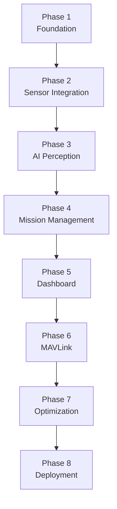

# AeroSentinel — Phased Implementation Plan

> **Version:** 0.1.0  
> **Platform:** Raspberry Pi 4B (ARM64, Bookworm 64-bit)  
> **Updated:** 2026-11-12  

---

## Overview

AeroSentinel is developed in **8 sequential phases**. Each phase must be fully accepted before the next begins. Phases 1–4 form the core system; Phases 5–8 add the operator interface, flight integration, and production hardening.

---

## Phase 1 — Foundation

**Goal:** Establish the project repository, configuration system, logging infrastructure, hardware detection, and diagnostics suite.

### Tasks

| # | Task | Owner Module |
|---|---|---|
| 1.1 | Initialize Git repository at `d:\AeroSentinal_VK_2027` with `.gitignore` | Setup |
| 1.2 | Create `pyproject.toml`, `requirements.txt`, virtual environment | Setup |
| 1.3 | Implement `config_loader.py` — YAML config loading with environment variable overrides | K/Utils |
| 1.4 | Populate all 8 YAML config stubs with documented defaults | Config |
| 1.5 | Implement `logger.py` — structured JSON logger with rotation, per-module level control | K |
| 1.6 | Implement `performance.py` — FPS counter, latency tracker, queue-depth monitor | K/Utils |
| 1.7 | Write `check_hardware.sh` — detect Pi model, camera, D435i, USB 3.0 connection | Scripts |
| 1.8 | Write `sensor_health.py` — runtime health checks for all hardware components | E |
| 1.9 | Write `install_dependencies.sh` — system package + pip install script for RPi Bookworm | Scripts |
| 1.10 | Create unit tests for config_loader and logger | Tests |

### Acceptance Criteria

- [ ] `python -m aerosentinel.utils.config_loader` loads all configs without error
- [ ] Logs appear in `data/logs/` as valid JSON Lines
- [ ] `check_hardware.sh` correctly identifies presence/absence of Pi Camera 3 and D435i
- [ ] All Phase 1 unit tests pass: `pytest tests/unit/ -k phase1`
- [ ] `python -m aerosentinel.sensors.sensor_health` exits 0 on healthy system

### Complexity: **Low**
### Dependencies: Python 3.9+, PyYAML, python-dotenv, structlog

---

## Phase 2 — Sensor Integration

**Goal:** Establish reliable, production-quality drivers for Pi Camera 3, RealSense D435i, and IMU; deliver calibrated frame streams.

### Tasks

| # | Task | Owner Module |
|---|---|---|
| 2.1 | Implement `picamera_driver.py` — Picamera2 initialization, resolution/FPS config, frame capture loop | A |
| 2.2 | Implement `realsense_driver.py` — librealsense2 pipeline, depth + RGB + IMU streams | A |
| 2.3 | Implement `camera_manager.py` — unified `FramePacket` producer, reconnection logic, frame rate limiting | A |
| 2.4 | Define `FramePacket`, `DepthFrame`, `IMUState` dataclasses in `src/aerosentinel/cameras/` | A |
| 2.5 | Implement `imu_processor.py` — complementary filter (roll/pitch), vibration detection | E |
| 2.6 | Populate `calibration/rgb_camera/` with intrinsics calibration procedure doc | Docs |
| 2.7 | Populate `calibration/realsense/` with D435i factory calibration extraction script | Docs |
| 2.8 | Write hardware integration tests (requires physical hardware) | Tests |
| 2.9 | Benchmark camera capture CPU/RAM on RPi 4 and document results | Phase 7 prep |

### Acceptance Criteria

- [ ] Pi Camera 3 delivers 1920×1080 @ 30 FPS via Picamera2 without crashes over 5 minutes
- [ ] RealSense D435i delivers 640×480 depth @ 15 FPS + 848×480 RGB @ 15 FPS over USB 3.0 without drops
- [ ] IMU stream delivers accel + gyro at ≥ 100 Hz
- [ ] `camera_rgb_queue` and `realsense_depth_queue` populated correctly, bounded at max sizes
- [ ] Reconnection test: unplug and replug RealSense → system recovers within 10 seconds
- [ ] Hardware tests in `tests/hardware/` pass on target RPi 4

### Complexity: **Medium-High** (ARM64 librealsense build, USB bandwidth management)
### Dependencies: Phase 1; `picamera2`, `librealsense2` (source build), `pyrealsense2`, `numpy`, `opencv-python-headless`

---

## Phase 3 — AI Perception

**Goal:** Implement the full AI perception pipeline: YOLO inference, depth-based obstacle detection, RGB-D fusion, and hazard classification.

### Tasks

| # | Task | Owner Module |
|---|---|---|
| 3.1 | Download and validate YOLOv8n ONNX model (320×320 input) to `models/` | B |
| 3.2 | Implement `inference_engine.py` — ONNX Runtime session, pre/post-processing | B |
| 3.3 | Implement `detector.py` — inference loop, NMS, `DetectionResult` output | B |
| 3.4 | Implement `depth_processor.py` — depth filter chain (temporal, spatial, hole-fill) | C |
| 3.5 | Implement `obstacle_detector.py` — zone-based min-distance obstacle map | C |
| 3.6 | Implement `rgbd_fusion.py` — `rs.align()` integration, 3D position estimation | D |
| 3.7 | Implement `hazard_detector.py` — multi-source hazard classification logic | G |
| 3.8 | Benchmark inference FPS on RPi 4 at 320×320 (target ≥ 3 FPS) | B |
| 3.9 | Evaluate alternative models: YOLOv5n-ONNX, MobileNetSSD (document trade-offs) | B |
| 3.10 | Write unit tests with mock camera/depth frames | Tests |
| 3.11 | Write integration test: full pipeline E2E with recorded frames | Tests |

### Acceptance Criteria

- [ ] YOLOv8n ONNX achieves ≥ 3 FPS on RPi 4 CPU at 320×320
- [ ] Detections on COCO benchmark images match expected results (mAP within 2% of reference)
- [ ] `obstacle_detector.py` correctly flags obstacles within 1.0 m safety zone in depth tests
- [ ] `rgbd_fusion.py` produces 3D position estimate within ±20 cm for objects at 0.5–3.0 m (calibrated rig test)
- [ ] Hazard detection unit tests pass with mock data
- [ ] No memory leaks over 10-minute run (monitored via `performance.py`)

### Complexity: **High** (CPU inference optimization, depth processing, spatial math)
### Dependencies: Phase 2; `onnxruntime`, `opencv-python-headless`, YOLOv8n ONNX model file

---

## Phase 4 — Mission Management

**Goal:** Implement mission lifecycle management, persistent storage, and report generation.

### Tasks

| # | Task | Owner Module |
|---|---|---|
| 4.1 | Design SQLite schema for missions, detections, hazards, telemetry snapshots | H/Storage |
| 4.2 | Implement `database.py` — connection pool, schema migrations, CRUD helpers | Storage |
| 4.3 | Implement `models.py` — SQLAlchemy (or plain sqlite3) ORM models | Storage |
| 4.4 | Implement `mission_manager.py` — lifecycle state machine, event handling | H |
| 4.5 | Implement `mission_recorder.py` — write detections/hazards to DB in background thread | H |
| 4.6 | Implement `report_generator.py` — JSON + Markdown SAR report output | H |
| 4.7 | Write migration script for schema versioning | Storage |
| 4.8 | Unit tests for all state machine transitions | Tests |
| 4.9 | Integration test: full mission from start to report | Tests |

### Acceptance Criteria

- [ ] Mission state machine correctly handles all transitions (IDLE→ACTIVE→PAUSED→COMPLETED→ABORTED)
- [ ] All detections persisted to SQLite within 2 seconds of event
- [ ] `report_generator.py` produces valid JSON and human-readable Markdown reports
- [ ] Database survives power loss (WAL mode enabled)
- [ ] Schema migration script runs idempotently

### Complexity: **Medium**
### Dependencies: Phase 3; `sqlite3` (stdlib), optionally `sqlalchemy`

---

## Phase 5 — Ground Control Dashboard

**Goal:** Build the real-time web dashboard for operator situational awareness and mission control.

### Tasks

| # | Task | Owner Module |
|---|---|---|
| 5.1 | Implement `app.py` — FastAPI application factory, middleware, CORS | J |
| 5.2 | Implement `api.py` — REST endpoints: status, telemetry, detections, mission | J |
| 5.3 | Implement `websocket.py` — WebSocket manager for live event broadcast | J |
| 5.4 | Design and implement HTML/CSS dashboard (`templates/index.html`, `static/`) | J |
| 5.5 | Implement MJPEG / JPEG snapshot endpoint for camera feed | J |
| 5.6 | Build detection alert UI: bounding box overlay, Confirm/Dismiss buttons | J |
| 5.7 | Build mission control panel: Start/Pause/Stop, status indicators | J |
| 5.8 | Build telemetry panel: altitude, speed, battery, attitude display | J |
| 5.9 | Implement HTTPS + basic auth (self-signed cert for field use) | J |
| 5.10 | Load test: simulate 100 WebSocket events/sec; verify no message loss | Tests |

### Acceptance Criteria

- [ ] Dashboard loads in browser at `http://<pi-ip>:8080` within 2 seconds
- [ ] WebSocket delivers detection events within 500 ms of detection
- [ ] Camera JPEG feed updates at ≥ 5 FPS in browser
- [ ] Confirm/Dismiss buttons correctly publish `DETECTION_CONFIRMED` / `DETECTION_DISMISSED` events
- [ ] Mission Start/Stop commands correctly trigger `MISSION_COMMAND` events
- [ ] Dashboard remains responsive (< 1 s lag) while AI pipeline runs at full load

### Complexity: **Medium**
### Dependencies: Phase 4; `fastapi`, `uvicorn`, `websockets`, `jinja2`

---

## Phase 6 — MAVLink Integration

**Goal:** Implement read-only MAVLink telemetry reception from flight controller.

### Tasks

| # | Task | Owner Module |
|---|---|---|
| 6.1 | Implement `mavlink_client.py` — pymavlink connection (UART + UDP), heartbeat loop | I |
| 6.2 | Implement `telemetry.py` — message parsers for HEARTBEAT, ATTITUDE, GLOBAL_POSITION_INT, BATTERY_STATUS, VFR_HUD | I |
| 6.3 | Implement `flight_status.py` — `FlightTelemetry` dataclass, connection state machine | I |
| 6.4 | Write MAVLink safety audit: static code review, confirm no write commands | I/Safety |
| 6.5 | Implement FC disconnect/reconnect with exponential backoff | I |
| 6.6 | Configure UART: `/dev/ttyAMA0`, 921600 baud (disable BT UART if needed) | Setup |
| 6.7 | Test with SITL (ArduPilot Software-In-The-Loop) over UDP | Tests |
| 6.8 | Verify telemetry appears correctly in dashboard | J |

### Acceptance Criteria

- [ ] Telemetry received from SITL at ≥ 2 Hz for all subscribed message types
- [ ] `FC_CONNECTED` and `FC_DISCONNECTED` events published correctly
- [ ] Safety audit document confirms zero write-path MAVLink commands in codebase
- [ ] Dashboard telemetry panel shows live data from SITL
- [ ] No `COMMAND_LONG`, `SET_MODE`, `RC_CHANNELS_OVERRIDE` message sends in entire codebase (automated grep test)

### Complexity: **Low-Medium**
### Dependencies: Phase 5; `pymavlink`, ArduPilot SITL for testing

---

## Phase 7 — Optimization

**Goal:** Profile and optimize the full system for sustained RPi 4 operation under thermal and load constraints.

### Tasks

| # | Task | Owner Module |
|---|---|---|
| 7.1 | Run `benchmark_pi4.sh` — full pipeline FPS, CPU%, RAM, temperature | Perf |
| 7.2 | Identify bottlenecks; optimize inference pipeline (input resize strategy, batch norm fusion) | B |
| 7.3 | Implement adaptive FPS: reduce inference rate when CPU temp > 80°C | B/K |
| 7.4 | Optimize queue depths based on measured latency | All |
| 7.5 | Profile memory usage; fix any leaks with tracemalloc | All |
| 7.6 | Evaluate ONNX quantization (INT8 vs FP32) for inference speed | B |
| 7.7 | Test sustained 30-min operation: confirm no thermal throttle crashes | Tests |
| 7.8 | Document benchmarks in `HARDWARE_COMPATIBILITY.md` | Docs |

### Acceptance Criteria

- [ ] Full pipeline (all modules) sustains ≥ 3 FPS AI inference for 30 minutes without crash
- [ ] CPU temperature stays ≤ 85°C with active cooling during full-load run
- [ ] RAM usage stays ≤ 2 GB during full-load run
- [ ] No memory leaks detected over 30-minute run (tracemalloc baseline delta < 50 MB)
- [ ] Adaptive FPS throttling activates correctly at 80°C threshold

### Complexity: **Medium**
### Dependencies: Phase 6 (all modules running)

---

## Phase 8 — Deployment

**Goal:** Package AeroSentinel as a production-ready systemd service with install scripts and documentation.

### Tasks

| # | Task | Owner Module |
|---|---|---|
| 8.1 | Write `start_aerosentinel.sh` — virtual env activation, pre-flight checks, launch | Scripts |
| 8.2 | Create `aerosentinel.service` — systemd unit file with restart policy | Scripts |
| 8.3 | Write `install_dependencies.sh` — full automated setup from fresh RPi Bookworm | Scripts |
| 8.4 | Write `setup_realsense.sh` — librealsense source build and install automation | Scripts |
| 8.5 | Finalize all documentation in `docs/` | Docs |
| 8.6 | Write `docs/installation.md` — step-by-step installation guide | Docs |
| 8.7 | Write `docs/hardware_setup.md` — wiring, mounting, power, USB port assignment | Docs |
| 8.8 | Write `docs/troubleshooting.md` — common issues and solutions | Docs |
| 8.9 | Create Docker image (optional, for dashboard development on non-Pi hardware) | Infra |
| 8.10 | Final end-to-end field test on physical drone (tethered, controlled environment) | Tests |

### Acceptance Criteria

- [ ] Fresh RPi Bookworm → `install_dependencies.sh` → `setup_realsense.sh` → system running in < 90 minutes
- [ ] `systemctl enable aerosentinel` → auto-starts on boot, restarts on crash
- [ ] All `docs/` pages render correctly in Markdown viewer
- [ ] Field test: system detects a person-shaped mannequin at 2 m distance within 10 seconds of mission start
- [ ] CHANGELOG.md updated to v1.0.0

### Complexity: **Low**
### Dependencies: Phase 7

---

## Dependency Graph

---

## Effort Estimates

| Phase | Estimated Dev Days | Complexity |
|---|---|---|
| 1 — Foundation | 2–3 days | Low |
| 2 — Sensor Integration | 5–7 days | Medium-High |
| 3 — AI Perception | 7–10 days | High |
| 4 — Mission Management | 3–5 days | Medium |
| 5 — Dashboard | 4–6 days | Medium |
| 6 — MAVLink | 2–3 days | Low-Medium |
| 7 — Optimization | 3–5 days | Medium |
| 8 — Deployment | 2–3 days | Low |
| **Total** | **28–42 days** | |

---

*Plan subject to revision after each phase's acceptance criteria review.*
