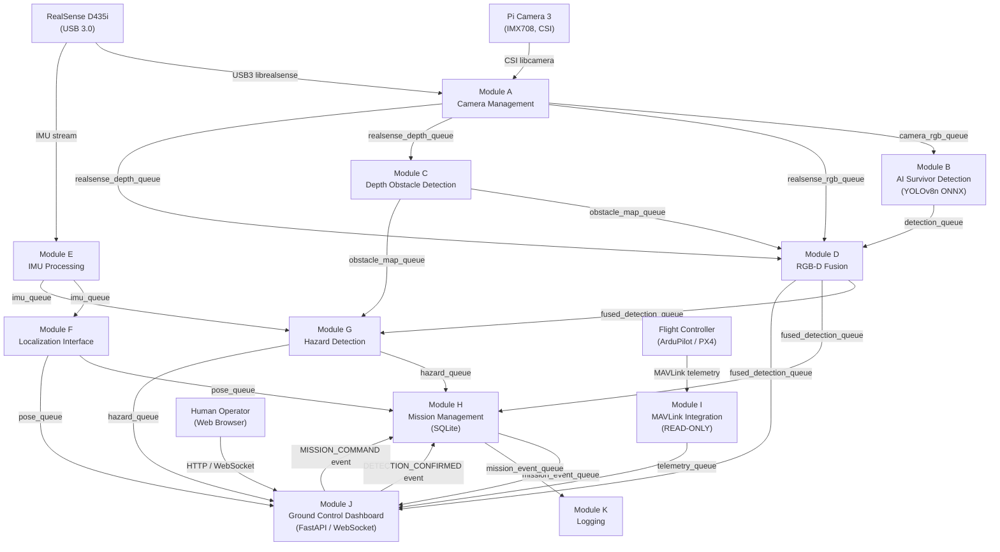
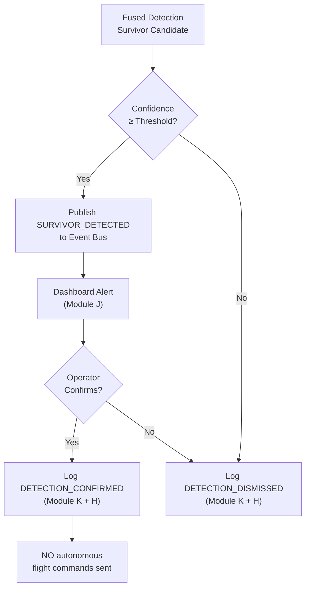
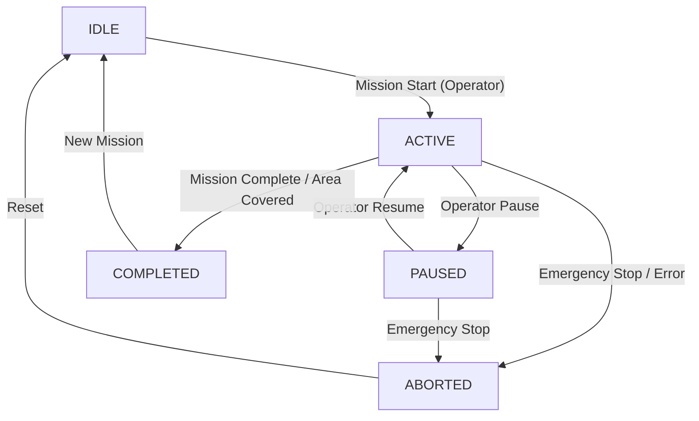

# AeroSentinel — System Architecture

> **Version:** 0.1.0  
> **Platform:** Raspberry Pi 4B (ARM64, 4 GB RAM)  
> **Date:** 2026-11-12  
> **Status:** Design Phase

---

## Table of Contents

1. [System Overview & Goals](#1-system-overview--goals)
2. [Hardware Configuration](#2-hardware-configuration)
3. [Module Breakdown](#3-module-breakdown)
4. [Inter-Module Communication](#4-inter-module-communication)
5. [Data Flow Diagrams](#5-data-flow-diagrams)
6. [Safety Architecture](#6-safety-architecture)
7. [Performance Constraints](#7-performance-constraints)
8. [Upgrade Path](#8-upgrade-path)

---

## 1. System Overview & Goals

AeroSentinel is an AI-powered autonomous drone system designed for **disaster search-and-rescue (SAR)** operations. The system runs entirely on a **Raspberry Pi 4B** (no cloud dependency, no Jetson, no thermal camera, no GPS assumed) and provides:

| Goal | Description |
|---|---|
| **Survivor Detection** | Real-time AI inference (YOLOv8n ONNX) on RGB frames to locate people in debris |
| **Obstacle Avoidance Data** | Depth-based obstacle mapping from Intel RealSense D435i |
| **RGB-D Fusion** | Merged spatial understanding from Pi Camera 3 (colour) + D435i (depth) |
| **Situational Awareness** | Hazard detection, mission logging, telemetry monitoring |
| **Ground Station Dashboard** | Real-time web UI for operator confirmation and mission control |
| **Safety-First Design** | MAVLink read-only; no autonomous arming, takeoff, or motor commands |

### Design Principles

- **Human-in-the-loop**: All detection alerts require operator confirmation before any action recommendation is transmitted.
- **Resource-bounded**: All queues and frame buffers are capped to prevent memory exhaustion.
- **Fail-safe**: Sensor failures degrade gracefully; the system never silently drops safety-critical events.
- **Modular**: Each subsystem (A–K) is independently testable and replaceable.

---

## 2. Hardware Configuration

### 2.1 Raspberry Pi 4B

| Attribute | Value |
|---|---|
| CPU | Broadcom BCM2711, 4-core ARM Cortex-A72 @ 1.5–1.8 GHz (OC) |
| RAM | 4 GB LPDDR4-3200 |
| Storage | 64+ GB microSD (Class 10 / UHS-I recommended) or USB 3.0 SSD |
| OS | Raspberry Pi OS Bookworm 64-bit (Debian 12) |
| Connectivity | 2× USB 3.0, 2× USB 2.0, Gigabit Ethernet, Wi-Fi 802.11ac, BT 5.0 |
| GPIO | 40-pin HAT; used for IMU (I²C), status LEDs |
| Power | 5 V / 3 A USB-C (from drone BEC or power distribution board) |
| Accelerator | **None** — CUDA not available; inference is CPU-only |

### 2.2 Raspberry Pi Camera Module 3

| Attribute | Value |
|---|---|
| Sensor | Sony IMX708, 12 MP, 1/2.43" |
| Resolution | Up to 4608×2592; AeroSentinel uses 1920×1080 @ 30 FPS |
| Interface | CSI-2 (MIPI) via ribbon cable to RPi 4 CSI port |
| Software Stack | `libcamera` → `Picamera2` Python API |
| FOV | 102° diagonal (wide) |
| Notes | Auto-focus (AF) supported; fixed focus mode available for stability |

### 2.3 Intel RealSense D435i

| Attribute | Value |
|---|---|
| Type | Active IR stereo depth + RGB |
| Depth Range | 0.1 m – 10 m (optimal 0.3–3 m) |
| Depth Resolution | Up to 1280×720 @ 30 FPS; AeroSentinel uses 640×480 @ 15 FPS |
| RGB Resolution | Up to 1920×1080; AeroSentinel uses 848×480 @ 15 FPS |
| IMU | Built-in BMI055 (3-axis accel + gyro) |
| Interface | **USB 3.0 required** (USB 2.0 limited to low-resolution / low-FPS) |
| Software | `librealsense2` (must be compiled from source for ARM64) + `pyrealsense2` |
| Notes | USB bandwidth is shared with Pi Camera 3 CSI; keep D435i on dedicated USB 3.0 port |

### 2.4 System Block Diagram

```
┌──────────────────────────────────────────────────────────────────┐
│                    Raspberry Pi 4B                               │
│                                                                  │
│  CSI  ┌─────────────────┐    USB3  ┌───────────────────────┐    │
│ ──────►  Pi Camera 3    │          │ Intel RealSense D435i │    │
│       │  (IMX708 12MP)  │          │  Depth + RGB + IMU    │    │
│       └────────┬────────┘          └──────────┬────────────┘    │
│                │ libcamera/Picamera2           │ librealsense2   │
│       ┌────────▼─────────────────────────────▼────────────┐     │
│       │            AeroSentinel Software Stack             │     │
│       │  Modules A–K (Python 3.9+, asyncio + threads)     │     │
│       └────────────────────────┬───────────────────────────┘     │
│                                │                                 │
│        USB/UART  ┌─────────────▼──────────┐  Ethernet/Wi-Fi    │
│        ─────────►│  Flight Controller     │◄──── GCS Dashboard  │
│                  │  (MAVLink READ-ONLY)   │                     │
│                  └────────────────────────┘                     │
└──────────────────────────────────────────────────────────────────┘
```

---

## 3. Module Breakdown

### Module A — Camera Management

**File:** `src/aerosentinel/cameras/camera_manager.py`

**Responsibilities:**
- Initialize and configure Pi Camera 3 via `Picamera2`
- Initialize and stream RGB frames from RealSense D435i via `pyrealsense2`
- Provide unified `FramePacket` objects (timestamp, frame_id, source, image array)
- Handle camera reconnection on failure
- Apply frame rate limiting (target 10–15 FPS for AI pipeline)

**Interfaces:**
- **Produces:** `camera_rgb_queue` (bounded, `FramePacket`)
- **Produces:** `realsense_rgb_queue` (bounded, `FramePacket`)
- **Subscribes to:** Event bus topic `CAMERA_CONFIG_UPDATE`
- **Publishes:** Event bus topics `CAMERA_READY`, `CAMERA_ERROR`, `CAMERA_RECONNECTED`

**Key Design Decisions:**
- Pi Camera 3 is primary RGB source for AI inference; RealSense RGB used for calibration/fusion alignment
- Both cameras produce JPEG-compressed and raw NumPy array variants
- Frame dropping occurs silently when downstream queues are full (non-blocking put)

---

### Module B — AI Survivor Detection

**File:** `src/aerosentinel/perception/detector.py` + `inference_engine.py`

**Responsibilities:**
- Run YOLOv8n ONNX model (320×320 input) on RGB frames
- Produce bounding boxes, class labels, confidence scores
- Apply confidence thresholding (configurable, default 0.5)
- Enqueue `DetectionResult` objects for downstream fusion and dashboard

**Interfaces:**
- **Consumes:** `camera_rgb_queue`
- **Produces:** `detection_queue` (bounded)
- **Publishes:** Event bus topic `SURVIVOR_DETECTED` (confidence > threshold)
- **Subscribes to:** `AI_CONFIG_UPDATE`

**Key Design Decisions:**
- ONNX Runtime CPU provider only (no CUDA, no TensorRT, no RKNN)
- Runs in a dedicated thread with its own GIL-releasing C extension (ONNX Runtime)
- Input resolution fixed at 320×320 for ≥3 FPS target on RPi 4
- NMS post-processing done in NumPy

---

### Module C — Depth Obstacle Detection

**File:** `src/aerosentinel/perception/depth_processor.py` + `obstacle_detector.py`

**Responsibilities:**
- Receive depth frames from RealSense D435i
- Apply depth filtering (temporal, spatial, hole-filling via `rs.filter`)
- Compute minimum-distance obstacle map in configurable zones
- Generate `ObstacleAlert` events when obstacles breach safety thresholds

**Interfaces:**
- **Consumes:** `realsense_depth_queue` (bounded)
- **Produces:** `obstacle_map_queue` (bounded)
- **Publishes:** `OBSTACLE_DETECTED`, `OBSTACLE_CLEARED`
- **Subscribes to:** `DEPTH_CONFIG_UPDATE`

---

### Module D — RGB-D Fusion

**File:** `src/aerosentinel/perception/rgbd_fusion.py`

**Responsibilities:**
- Align RealSense depth frame to RGB colour space using D435i intrinsics
- Project detected bounding boxes (from Module B) into 3D space using depth
- Produce `FusedDetection` with (x, y, z) position estimate in camera frame
- Apply temporal smoothing on 3D positions

**Interfaces:**
- **Consumes:** `detection_queue`, `obstacle_map_queue`
- **Produces:** `fused_detection_queue`
- **Publishes:** `FUSED_DETECTION_READY`

**Key Design Decisions:**
- Uses RealSense SDK's built-in `rs.align()` to align depth to colour
- 3D position estimated by sampling depth in a central 10×10 patch inside each bounding box
- Falls back to depth-less 2D detections if depth unavailable

---

### Module E — IMU Processing

**File:** `src/aerosentinel/sensors/imu_processor.py`

**Responsibilities:**
- Read IMU data from RealSense D435i built-in BMI055 (accel + gyro)
- Complementary filter for roll/pitch estimation
- Detect vibration anomalies (drone instability indicator)
- Produce `IMUState` at 100 Hz (configurable)

**Interfaces:**
- **Produces:** `imu_queue` (bounded, `IMUState`)
- **Publishes:** `IMU_READY`, `HIGH_VIBRATION_DETECTED`
- **Subscribes to:** `IMU_CONFIG_UPDATE`

---

### Module F — Localization Interface

**File:** `src/aerosentinel/localization/localization_interface.py`

**Responsibilities:**
- Abstract localization source (currently: placeholder/dead-reckoning)
- Future: plug in visual odometry (Module F-VO) or SLAM (Module F-SLAM)
- Provide current pose estimate `PoseEstimate` to mission and dashboard
- Accept correction signals from upstream modules

**Interfaces:**
- **Consumes:** `imu_queue`, `fused_detection_queue`
- **Produces:** `pose_queue` (bounded)
- **Publishes:** `POSE_UPDATED`, `LOCALIZATION_LOST`

**Notes:** In v0.1, this returns a stub `PoseEstimate(x=0, y=0, z=0, confidence=0.0)`.

---

### Module G — Hazard Detection

**File:** `src/aerosentinel/perception/hazard_detector.py`

**Responsibilities:**
- Combine obstacle data (Module C), IMU (Module E), and fused detections (Module D)
- Classify environmental hazards: `NARROW_PASSAGE`, `SUDDEN_DROP`, `UNSTABLE_PLATFORM`
- Rate and log hazard severity (LOW/MEDIUM/HIGH/CRITICAL)
- Publish hazard events for mission logging and dashboard

**Interfaces:**
- **Consumes:** `obstacle_map_queue`, `imu_queue`, `fused_detection_queue`
- **Produces:** `hazard_queue` (bounded)
- **Publishes:** `HAZARD_DETECTED`, `HAZARD_CLEARED`

---

### Module H — Mission Management

**File:** `src/aerosentinel/mission/mission_manager.py`

**Responsibilities:**
- Manage mission lifecycle: `IDLE → ACTIVE → PAUSED → COMPLETED → ABORTED`
- Record all detections and hazards to SQLite database
- Generate mission reports (JSON + human-readable)
- Manage area coverage tracking (grid-based)

**Interfaces:**
- **Consumes:** `fused_detection_queue`, `hazard_queue`, `pose_queue`
- **Produces:** `mission_event_queue`
- **Publishes:** `MISSION_STARTED`, `MISSION_COMPLETED`, `DETECTION_RECORDED`
- **Subscribes to:** `MISSION_COMMAND` (from dashboard via event bus)

---

### Module I — MAVLink Integration

**File:** `src/aerosentinel/flight/mavlink_client.py` + `telemetry.py`

**Responsibilities:**
- Connect to flight controller via UART (`/dev/ttyAMA0`) or UDP
- Subscribe to MAVLink messages: `HEARTBEAT`, `ATTITUDE`, `GLOBAL_POSITION_INT`, `SYS_STATUS`, `BATTERY_STATUS`, `VFR_HUD`
- Parse and normalize telemetry into `FlightTelemetry` objects
- **NEVER** send arming, mode-change, or motor commands

**Interfaces:**
- **Produces:** `telemetry_queue` (bounded, `FlightTelemetry`)
- **Publishes:** `TELEMETRY_UPDATED`, `FC_CONNECTED`, `FC_DISCONNECTED`
- **Subscribes to:** `MAVLINK_CONFIG_UPDATE`

**Safety Constraints:**
- No `COMMAND_LONG` messages with `MAV_CMD_COMPONENT_ARM_DISARM`
- No `SET_MODE` messages
- No `RC_CHANNELS_OVERRIDE`
- Connection is **read-only** by design; write path is intentionally not implemented

---

### Module J — Ground Control Dashboard

**File:** `src/aerosentinel/dashboard/`

**Responsibilities:**
- Serve real-time web UI via FastAPI (port 8080)
- WebSocket feed for live detections, telemetry, hazard alerts
- MJPEG/JPEG snapshot endpoint for camera feed preview
- Operator confirmation UI for detections (acknowledge/dismiss)
- Mission control panel (start/pause/stop mission)

**Interfaces:**
- **Consumes:** `fused_detection_queue`, `telemetry_queue`, `hazard_queue`, `mission_event_queue`
- **Publishes:** `MISSION_COMMAND`, `DETECTION_CONFIRMED`, `DETECTION_DISMISSED`
- **API Endpoints:**
  - `GET /api/status` — system health
  - `GET /api/telemetry` — latest telemetry snapshot
  - `GET /api/detections` — recent detections
  - `GET /api/mission` — current mission state
  - `POST /api/mission/start` — start mission
  - `POST /api/mission/stop` — stop mission
  - `WS /ws/live` — real-time event stream

---

### Module K — Logging

**File:** `src/aerosentinel/utils/logger.py`

**Responsibilities:**
- Structured JSON logging with rotation (max 100 MB, 10 files)
- Per-module log levels configurable at runtime
- Performance metrics logging (FPS, latency, queue depths)
- Event bus event logging for audit trail

**Interfaces:**
- **Singleton** accessible to all modules
- **Writes to:** `data/logs/aerosentinel_YYYYMMDD.jsonl`
- **Publishes:** None (passive sink)

---

## 4. Inter-Module Communication

### 4.1 Architecture: Hybrid Queue + Event Bus

AeroSentinel uses a **hybrid communication model**:

1. **Bounded Thread-Safe Queues** (`queue.Queue` with `maxsize`) — for high-frequency streaming data (frames, detections, IMU). Frame dropping occurs when producers outpace consumers.
2. **Event Bus** (`asyncio` pub/sub in-process) — for state change notifications, commands, and alerts. All modules can subscribe to named topics.

### 4.2 Queue Registry

| Queue Name | Producer | Consumer(s) | Max Size | Type |
|---|---|---|---|---|
| `camera_rgb_queue` | Module A | Module B | 4 | `FramePacket` |
| `realsense_rgb_queue` | Module A | Module D | 4 | `FramePacket` |
| `realsense_depth_queue` | Module A | Module C, D | 4 | `DepthFrame` |
| `detection_queue` | Module B | Module D | 8 | `DetectionResult` |
| `obstacle_map_queue` | Module C | Module D, G | 4 | `ObstacleMap` |
| `fused_detection_queue` | Module D | Module G, H, J | 16 | `FusedDetection` |
| `imu_queue` | Module E | Module F, G | 32 | `IMUState` |
| `pose_queue` | Module F | Module H, J | 8 | `PoseEstimate` |
| `hazard_queue` | Module G | Module H, J | 16 | `HazardEvent` |
| `telemetry_queue` | Module I | Module J | 8 | `FlightTelemetry` |
| `mission_event_queue` | Module H | Module J, K | 32 | `MissionEvent` |

### 4.3 Event Bus Topics

| Topic | Publisher | Subscriber(s) | Description |
|---|---|---|---|
| `CAMERA_READY` | A | H, J | Camera initialized |
| `CAMERA_ERROR` | A | H, J, K | Camera failure |
| `SURVIVOR_DETECTED` | B | H, J | High-confidence detection |
| `OBSTACLE_DETECTED` | C | G, J | Obstacle within safety radius |
| `FUSED_DETECTION_READY` | D | H, J | 3D-located detection |
| `HIGH_VIBRATION_DETECTED` | E | G, H, J | IMU anomaly |
| `LOCALIZATION_LOST` | F | H, J | Pose confidence below threshold |
| `HAZARD_DETECTED` | G | H, J | Environmental hazard |
| `MISSION_STARTED` | H | J, K | Mission lifecycle |
| `DETECTION_CONFIRMED` | J | H, K | Operator confirmed detection |
| `FC_DISCONNECTED` | I | H, J | Flight controller link lost |
| `MAVLINK_CONFIG_UPDATE` | J | I | Config change via dashboard |

---

## 5. Data Flow Diagrams

### 5.1 Primary Perception Pipeline



### 5.2 Safety & Control Flow



### 5.3 Mission Lifecycle



---

## 6. Safety Architecture

### 6.1 Core Safety Principles

> **AeroSentinel does NOT control the drone.** It is a **perception and monitoring layer** that provides situational awareness to a human operator. All flight decisions remain with the pilot/autopilot.

### 6.2 MAVLink Safety Constraints

| Category | Status | Rationale |
|---|---|---|
| Arming commands | ❌ FORBIDDEN | `MAV_CMD_COMPONENT_ARM_DISARM` never sent |
| Mode change commands | ❌ FORBIDDEN | `SET_MODE` never sent |
| RC override | ❌ FORBIDDEN | `RC_CHANNELS_OVERRIDE` never sent |
| Waypoint upload | ❌ FORBIDDEN | `MISSION_ITEM_INT` never sent |
| Telemetry receive | ✅ ALLOWED | Heartbeat, attitude, position, battery |
| Parameter read | ✅ ALLOWED | `PARAM_REQUEST_READ` for diagnostics |

### 6.3 Bounded Queue Safety

All inter-module queues have explicit `maxsize` limits. When a queue is full:
- **High-frequency producers** (cameras, IMU): Drop the oldest frame silently, increment a dropped-frame counter, log a warning every 100 drops.
- **Alert producers** (hazard, detection): Block briefly (timeout 0.1 s), then log error if still full.

### 6.4 Sensor Failure Degradation

| Failure | System Response |
|---|---|
| Pi Camera 3 disconnects | Module B disabled; dashboard shows "RGB feed lost" |
| RealSense D435i disconnects | Module C, D, E disabled; Module B continues with 2D-only |
| Flight controller disconnects | Module I retries; dashboard shows "FC link lost" |
| IMU stream interrupted | Module E publishes `IMU_LOST`; Module G uses depth-only hazard detection |
| AI model load failure | Module B disabled; obstacle detection continues |

### 6.5 Human Confirmation Protocol

1. Module B detects survivor with confidence > threshold.
2. Event `SURVIVOR_DETECTED` published to bus.
3. Module H records `DETECTION_PENDING` in database.
4. Module J displays alert on dashboard with bounding box overlay.
5. Operator clicks **Confirm** or **Dismiss**.
6. Event `DETECTION_CONFIRMED` or `DETECTION_DISMISSED` published.
7. Module H updates record accordingly; no automated drone action triggered.

---

## 7. Performance Constraints

### 7.1 CPU Budget (RPi 4, 4-core Cortex-A72)

| Module | Estimated CPU % | Thread/Process | Priority |
|---|---|---|---|
| Pi Camera 3 capture | 10% | Thread | High |
| RealSense capture | 15% | Thread | High |
| AI Inference (YOLOv8n) | 50% | Thread (C ext) | Medium |
| Depth processing | 10% | Thread | Medium |
| RGB-D Fusion | 5% | Thread | Low |
| IMU processing | 3% | Thread | High |
| Dashboard / FastAPI | 5% | Asyncio | Low |
| Mission / Logging | 2% | Thread | Low |
| **Total** | **~100%** | | |

### 7.2 Frame Rate Targets

| Data Stream | Target FPS | Drop Policy |
|---|---|---|
| Pi Camera 3 → AI | 10 FPS | Drop if queue full |
| RealSense Depth | 15 FPS | Drop if queue full |
| AI Inference output | 3–8 FPS (hardware-limited) | No drop (bounded wait) |
| IMU | 100 Hz | Drop oldest |
| Dashboard refresh | 5 FPS (JPEG snapshot) | Skip if busy |

### 7.3 Memory Budget

| Component | Estimated RAM |
|---|---|
| OS + system | 400 MB |
| Python runtime | 150 MB |
| YOLOv8n ONNX model | 50 MB |
| Camera frame buffers (×4) | 60 MB |
| Depth frame buffers (×4) | 30 MB |
| SQLite + WAL | 20 MB |
| Dashboard (FastAPI) | 80 MB |
| **Total** | **~790 MB** (well within 4 GB) |

### 7.4 Thermal Management

- RPi 4 throttles at 85°C (CPU frequency reduced).
- **Recommendation:** Active cooling (heatsink + fan) is mandatory for sustained SAR operations.
- Module K logs CPU temperature every 30 seconds; `HIGH_TEMP_WARNING` event published at 75°C.
- AI inference target reduced from 10 FPS to 5 FPS when CPU temperature > 80°C.

---

## 8. Upgrade Path

### 8.1 Visual Odometry (Phase 9+)

- Implement `visual_odometry.py` using OpenCV optical flow or ORB feature matching between successive Pi Camera 3 frames.
- Plug into Module F's abstract `LocalizationInterface`.
- Expected accuracy: 5–15 cm drift per meter in good lighting.

### 8.2 SLAM (Phase 10+)

- Integrate `slam_adapter.py` with:
  - **ORB-SLAM3** (CPU-only, requires ≥ 1.5 GB RAM for map)
  - Or **RTAB-Map** (RGB-D SLAM using RealSense D435i natively)
- Provides persistent map, loop closure, and accurate localization.
- May require offloading map rendering to a companion computer via ROS 2 bridge.

### 8.3 Autonomous Navigation (Phase 11+)

- Once SLAM provides reliable pose, implement navigation planner in `navigation_interface.py`.
- Waypoint following via MAVLink (read AND write mode — requires explicit safety review and hardware-level RC failsafe).
- Must add hardware-level safety: physical RC override switch, geofence, altitude limit.

### 8.4 Multi-Sensor Fusion (Phase 12+)

- Add optional thermal camera (FLIR Lepton or Seek Thermal) for night / smoke conditions.
- Add optional GPS module for absolute localization.
- Sensor fusion via Extended Kalman Filter (EKF) in `localization_interface.py`.

### 8.5 Edge AI Accelerator (Phase 13+)

- Replace ONNX CPU inference with:
  - **Google Coral USB Accelerator** (Edge TPU, ~100 FPS on MobileNet-class models)
  - **Hailo-8L M.2 AI Accelerator** (available on RPi 5 M.2 HAT)
- Requires model conversion to TFLite (Coral) or Hailo Dataflow format.

---

*Document maintained by: AeroSentinel Architecture Team*  
*Next review: After Phase 2 (Sensor Integration) completion*
