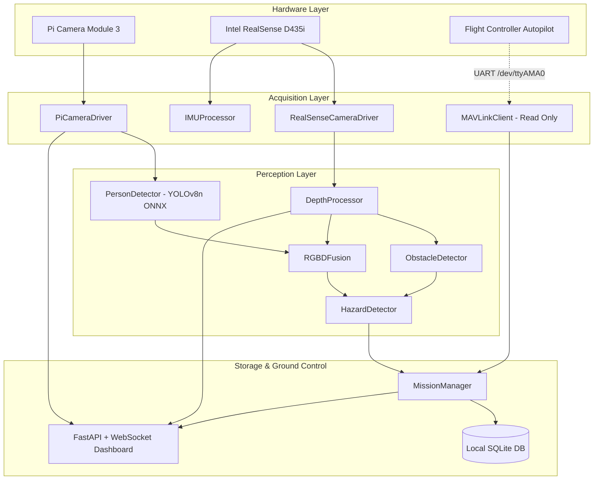

# AeroSentinel Architecture Documentation

## 1. System Architecture Overview
AeroSentinel adopts a modular, service-oriented architecture designed to run on resource-constrained embedded companion computers.
The architecture enforces strict separation between hardware acquisition, computer vision perception, telemetry ingestion, data logging, and ground station presentation.

## 2. Key Modules
- **Cameras (`src/aerosentinel/cameras/`):** Independent non-blocking capture threads for Pi Camera 3 and RealSense D435i with ring buffer queues (capacity=2) ensuring fresh frames without latency accumulation.
- **Perception (`src/aerosentinel/perception/`):** CPU-optimized ONNX Runtime inference using `yolov8n.onnx` at 320x320 resolution, spatial obstacle analysis across Left/Center/Right sectors, and RGB-D bounding box centroid depth association.
- **Sensors (`src/aerosentinel/sensors/`):** Low-pass filtered IMU readings from the RealSense D435i BMI085 IMU for tilt and vibration monitoring.
- **Flight (`src/aerosentinel/flight/`):** Passive MAVLink client tracking HEARTBEAT, BATTERY_STATUS, ATTITUDE, and GPS_RAW_INT without any actuation authority.
- **Storage (`src/aerosentinel/storage/`):** SQLite in WAL mode supporting concurrent high-frequency telemetry logging alongside detection snapshots.
- **Dashboard (`src/aerosentinel/dashboard/`):** Single-page application streaming JPEG-compressed frames and real-time telemetry over WebSockets.

